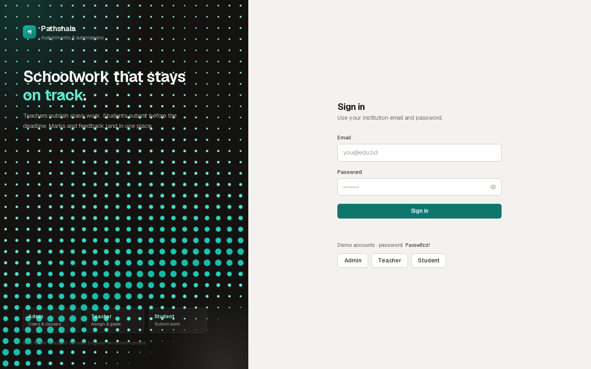
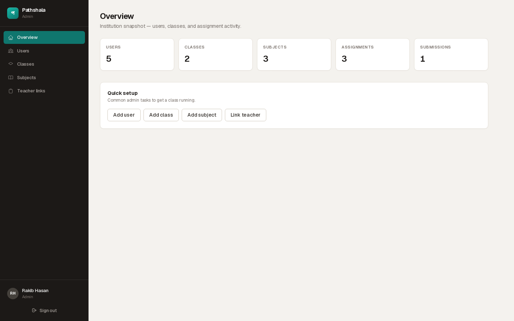
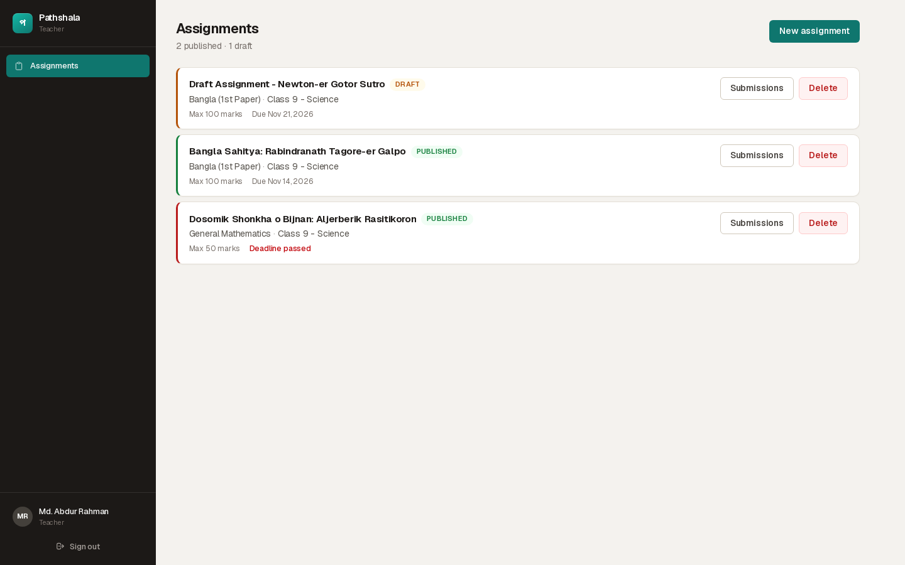
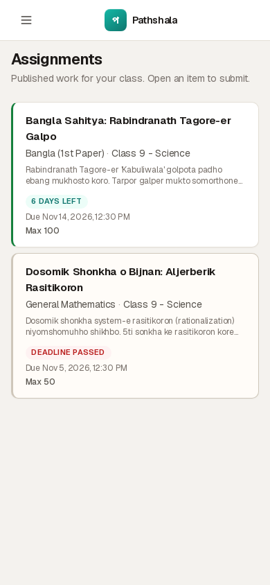

# Pathshala - Assignment and Submission Management System

[](https://github.com/Imnasir-X/pathshala-assignment-system/actions/workflows/ci.yml)
[](./LICENSE)


A role-based assignment, submission and grading system for schools and colleges, with an ASP.NET Core Web API, PostgreSQL and a Next.js frontend. Built by Nasir Khan as a recruitment project.

The product name in the UI is Pathshala (পাঠশালা).



| Admin overview | Teacher assignments | Student view on a phone |
|---|---|---|
|  |  |  |

## Features

### Role-based access (Admin, Teacher, Student)

- **Admin**: manage users, classes and courses, subjects, and teacher-subject assignments. Read access to all assignments and submissions.
- **Teacher**: create, update and delete assignments (draft or published) for their assigned class and subject. View and grade submissions with marks and feedback.
- **Student**: view published assignments for their class, submit answers, update submissions before the deadline, and see grades and feedback.

### Business rules enforced by the API

1. **Draft visibility**: draft assignments are invisible to students.
2. **Class scoping**: students can only see and submit to assignments for their own class.
3. **Deadline enforcement**: submissions after the deadline are rejected.
4. **Submission ownership**: students can only update their own submissions, and only before the deadline.
5. **Marks bounds**: marks cannot exceed the assignment's maximum or be negative.
6. **Teacher ownership**: teachers can only grade and view submissions for assignments they own.
7. **Backend-enforced authorization**: every protected endpoint has `[Authorize(Roles=...)]` plus service-layer ownership checks.

## Tech stack

| Layer | Technology |
|---|---|
| Backend | ASP.NET Core 9 Web API, C#, EF Core 9, PostgreSQL (Npgsql) |
| Auth | JWT bearer tokens, BCrypt password hashing |
| Validation | FluentValidation |
| Logging | Serilog (console and rolling file) |
| API docs | Swashbuckle (Swagger UI with JWT support) |
| Frontend | Next.js 16, React 19, TypeScript, Tailwind CSS 4 |
| Forms | react-hook-form and zod |
| Tests | xUnit, Moq, EF Core In-Memory |
| CI | GitHub Actions: .NET build and tests, API smoke test on PostgreSQL 17, frontend lint, type-check and build on Node 20 and 22 |

## Quick start

### Prerequisites

- .NET 9 SDK
- Node.js 20.9 or later (tested with Node 20 and 22)
- PostgreSQL 14 or later (tested with PostgreSQL 17)

### 1. Database

```bash
psql -U postgres -f database/setup.sql      # creates the assignment_system database
```

Tables are created by the EF Core migrations, which the API applies on startup.

### 2. Backend

The API needs a connection string and a JWT signing secret of at least 32 bytes. In Development a local-only key from `appsettings.Development.json` is used if you do not set one; in any other environment the API refuses to start without a private `Jwt__Secret`.

```bash
cd backend/AssignmentSystem.Api

# bash / zsh
export ASPNETCORE_ENVIRONMENT=Development
export ConnectionStrings__DefaultConnection="Host=localhost;Port=5432;Database=assignment_system;Username=postgres;Password=YOUR_PASSWORD"
export Jwt__Secret="$(openssl rand -base64 48)"

# Windows PowerShell
# $env:ASPNETCORE_ENVIRONMENT = "Development"
# $env:ConnectionStrings__DefaultConnection = "Host=localhost;Port=5432;Database=assignment_system;Username=postgres;Password=YOUR_PASSWORD"
# $env:Jwt__Secret = "<a random string of at least 32 characters>"

dotnet run
```

The API listens on `http://localhost:5000`. Swagger UI is at `/swagger` and a health check at `/health`. See `.env.example` for every setting.

### 3. Frontend

```bash
cd frontend
npm ci
cp .env.local.example .env.local   # edit if your API URL differs
npm run dev
```

The frontend runs on `http://localhost:3000`.

### 4. Tests and checks

```bash
dotnet test                        # from the repository root
cd frontend && npm run lint && npm run typecheck && npm run build
```

## Demo credentials

| Role | Email | Password |
|---|---|---|
| Admin | admin@edu.bd | Passw0rd! |
| Teacher | abdur.rahman@edu.bd | Passw0rd! |
| Student | sadia.islam@edu.bd | Passw0rd! |

These accounts are seeded on first run in the Development environment only (set `Seed__DemoData=true` to seed elsewhere, for a demo deployment). Passwords are stored as BCrypt hashes. Change or remove these accounts on any shared deployment.

## Project structure

```
pathshala-assignment-system/
├── backend/
│   ├── AssignmentSystem.Api/          # ASP.NET Core Web API
│   │   ├── Controllers/               # Auth, users, classes, subjects, assignments, submissions
│   │   ├── Services/                  # Business logic and rule enforcement
│   │   ├── Models/                    # EF Core entities
│   │   ├── Data/                      # AppDbContext and seed data
│   │   ├── Migrations/                # EF Core migrations
│   │   ├── DTOs/                      # Request and response DTOs
│   │   ├── Middleware/                # Global exception handler (RFC 7807)
│   │   ├── exceptions/                # Typed domain exceptions
│   │   └── Program.cs                 # DI, auth, Swagger, CORS, migration and seeding
│   └── AssignmentSystem.Tests/        # xUnit tests (28)
├── frontend/                          # Next.js app
│   └── src/
│       ├── app/                       # Pages: login, admin/*, teacher/*, student/*
│       ├── components/                # UI primitives and login animations
│       ├── lib/                       # API client, auth helpers, types
│       └── proxy.ts                   # Route protection by role (Next.js proxy)
├── database/                          # setup.sql, reset.sql, schema.sql (generated)
├── docs/                              # README screenshots
├── .github/workflows/ci.yml           # CI
├── .env.example                       # every configuration key
├── AssignmentSystem.sln
└── LICENSE
```

## API Endpoints

| Method & Route | Role | Description |
|---|---|---|
| `POST /api/auth/login` | Any | Authenticate and receive JWT |
| `GET/POST/PUT/DELETE /api/users` | Admin | User management |
| `GET/POST/PUT/DELETE /api/classes` | Admin | Class/course management |
| `GET/POST/PUT/DELETE /api/subjects` | Admin | Subject management |
| `GET /api/teacher-assignments` | Admin, Teacher | List teacher–subject–class links (teachers see only their own) |
| `POST/DELETE /api/teacher-assignments` | Admin | Assign / unassign teachers to subject+class |
| `GET /api/assignments` | All | Scoped by role (teacher sees own, student sees published+own class, admin sees all) |
| `POST /api/assignments` | Teacher | Create assignment (draft or published) |
| `PUT/DELETE /api/assignments/{id}` | Teacher (owner) | Update/delete own assignment |
| `GET /api/assignments/{id}/submissions` | Teacher (owner)/Admin | View submissions for assignment |
| `POST /api/submissions/{assignmentId}` | Student | Submit (enforces deadline + class scoping) |
| `PUT /api/submissions/{id}` | Student (owner) | Update before deadline |
| `PUT /api/submissions/{id}/grade` | Teacher (owner)/Admin | Grade with marks + feedback |
| `PUT /api/submissions/{id}/status` | Teacher (owner)/Admin | Change submission status (Submitted, Late, Graded, ReturnedForRevision) |
| `GET /api/submissions/mine` | Student | View own submissions |

## Test Coverage

28 unit tests covering all business rules:

- **Draft visibility**: Student list excludes drafts
- **Class scoping**: Student cannot submit to other class assignments
- **Deadline enforcement**: Submission after deadline throws `DeadlinePassedException`
- **Submission ownership**: Wrong student update throws `ForbiddenException`; Past deadline update throws `DeadlinePassedException`
- **Marks bounds**: Marks > maxMarks and negative marks throw `InvalidMarksException`
- **Teacher ownership**: Wrong teacher grading throws `ForbiddenException`
- **Duplicate submission**: One submission per student per assignment
- **Assignment CRUD**: Create, update, delete with ownership checks
- **Submission status**: Teacher can change submission status (e.g., Return for Revision)
- **Role scoping**: Teacher sees only own assignments; Student sees only published for own class; Admin sees all

## Assumptions

1. **Late submissions**: Not allowed. The deadline is a hard cutoff — submissions after the deadline are rejected. This simplifies the model and matches the most common real-world requirement.
2. **Re-grading**: Teachers can re-grade a submission (update marks/feedback after initial grading). This supports the workflow where a student requests a re-evaluation.
3. **One class per student**: Each student is enrolled in exactly one class. This is modeled via `StudentClassEnrollment` but the UI assumes a single class.
4. **One submission per student per assignment**: A unique constraint on `(AssignmentId, StudentId)` prevents multiple submissions. Updating the existing submission is the only way to revise.
5. **Admin grading**: Admins can grade any submission (bypassing teacher ownership) for operational flexibility, documented here explicitly.
6. **Token storage**: JWT is stored in `localStorage` for simplicity. This is a known XSS risk — for production, httpOnly cookies are preferred. This trade-off is documented for reviewers.

## Known Limitations

1. **Token storage**: Uses `localStorage` instead of httpOnly cookies. Acceptable for a demo project; would migrate to cookies for production.
2. **No frontend tests**: The backend has unit tests and CI runs an API smoke test against PostgreSQL; the frontend is linted, type-checked and built in CI but has no automated UI tests.
3. **No pagination UI**: Backend supports pagination, but the frontend loads up to 50 items per page without pagination controls.
4. **No file upload**: Submissions are text-only. File attachments would require additional storage and security considerations.
5. **No real-time updates**: No WebSocket/SSE for live submission notifications.
6. **PostgreSQL password**: The connection string requires the actual PostgreSQL password to be set via environment variable. `.env.example` shows the placeholder.

## License

Released under the [MIT License](./LICENSE). Copyright (c) 2026 Nasir Khan.
